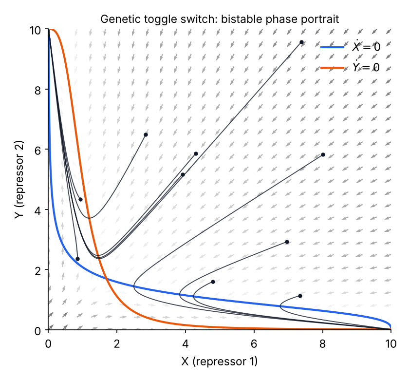
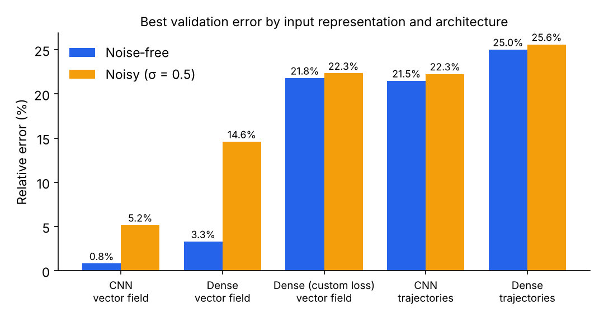
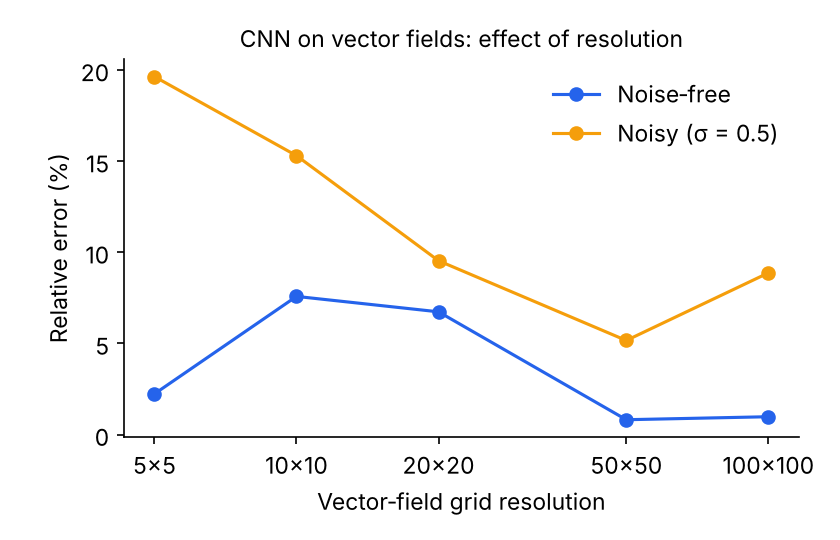

# Inferring the parameters of a genetic toggle switch with deep learning

**Can a neural network recover the parameters of a nonlinear dynamical system just by looking at its phase space?**

This repository contains the code, trained models and results of my M.Sc. thesis in Physics. I frame parameter
identification for the *genetic toggle switch* — a two‑gene circuit of mutual repression and a classic example of
biological bistability — as a supervised regression problem, and compare how well different input representations
and architectures recover all seven parameters, with and without stochastic noise.

<p align="center">
  
</p>

## The model

$$
\frac{dX}{dt} = \frac{a_1}{1 + Y^{n}} - d_1 X + b_1, \qquad
\frac{dY}{dt} = \frac{a_2}{1 + X^{n}} - d_2 Y + b_2
$$

| Parameter | Meaning | Range |
| --- | --- | --- |
| $a_1, a_2$ | maximal synthesis rates | 1 – 10 |
| $b_1, b_2$ | basal production | 0 – 10 |
| $d_1, d_2$ | degradation rates | 0 – 10 |
| $n$ | Hill coefficient (cooperativity) | 1 – 5 |

The task: given an observation of the system, predict the full vector $(a_1, a_2, b_1, b_2, d_1, d_2, n)$.

## Approach

**Synthetic data.** 10,000 random parameter sets (7,000 train / 2,000 validation / 1,000 test), each rendered in two
representations:

- **Vector field** — the velocity field $(\dot X, \dot Y)$ sampled on a regular grid over $[0,10]^2$, treated as a
  2‑channel image. Grid resolutions from 5×5 up to 100×100.
- **Trajectories** — 10 time series from different initial conditions, integrated numerically, with 10 to 200 time points each.

**Noise.** Noisy datasets add Gaussian noise (σ = 0.5) directly to the vector field, and simulate the trajectories as a
stochastic differential equation (Euler–Maruyama), so the network has to learn the parameters from realistic, imperfect
observations.

**Models.** Dense networks and convolutional networks (CNNs), with a bounded output layer matching the parameter
ranges and a per‑parameter MAE loss. I also tested a **physics-informed loss**: it rebuilds the vector field from the predicted parameters and penalizes the difference from the true field, without directly supervising the parameters.
Architectures and hyperparameters were tuned with **Optuna**, with learning-rate scheduling, L1 regularization and
early stopping.

**Metric.** Relative error = total absolute error over the seven parameters ÷ sum of the true parameters, on the validation set.

## Results

<p align="center">
  
</p>

- **The vector field is far more informative than trajectories.** A CNN on a 50×50 vector field recovers all seven
  parameters with **0.8 % relative error** (mean absolute error ≈ 0.02–0.05 per parameter on a 0–10 scale).
  Models trained on trajectories plateau at **~22 %**, whatever the architecture or sampling rate.
- **Convolutions matter once noise is added.** With noise, the CNN keeps the error at **5.2 %**. The dense network on
  the same input degrades from 3.3 % to 14.6 %.
- **The Hill coefficient is not the bottleneck.** With vector fields, $n$ is recovered as precisely as the rate
  constants. From trajectories, the synthesis rates $a_1, a_2$ are the hardest to identify.
- **The physics-informed loss shows which parameters the dynamics constrains.** It recovers the degradation rates
  very well ($d_{1,2}$ error ≈ 0.05) but not $a_{1,2}$ or $n$: different combinations of those parameters produce
  almost the same field, so they are poorly identifiable from the field alone. That is why direct supervision on
  the parameters works much better.

<p align="center">
  
</p>

Resolution helps up to about 50×50. Going further brings no improvement and makes the noisy case harder to fit.

## Repository layout

```
data_generation/          Synthetic datasets (noise-free and noisy) for every resolution
training_clean/           Training notebooks without noise, by resolution and architecture
  gridN_trajM/{cnn,dense,dense_custom_loss}/
training_noisy/           Same experiments with noise
trained_models_clean/     Trained Keras models (.h5)
trained_models_noisy/
results_clean/            Training histories (CSV) and plotting notebooks
results_noisy/
experiments_reduced_data/ Ablations with smaller training sets and variable input size
figures/                  Figures used in this README
```

`gridN_trajM` means an N×N vector-field grid and M time points per trajectory.

## Reproducing

1. Run a notebook in `data_generation/` to build the datasets. They are written to `data/clean/` or `data/noisy/`,
   which are not versioned because they take several GB.
2. Run the matching notebook in `training_clean/` or `training_noisy/`.
3. The pretrained models in `trained_models_*` can be loaded directly with `keras.models.load_model`.

Stack: Python · TensorFlow/Keras · Optuna · NumPy/SciPy · pandas · Matplotlib
